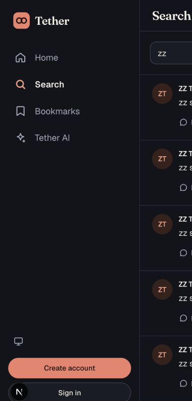
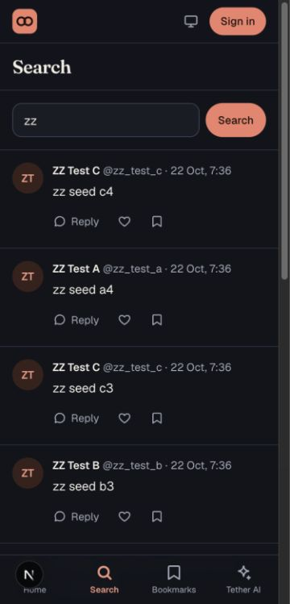

# Phase 5 — Search

Search is public at `/search?q=…`. A GET form submits only when the visitor presses Enter or selects Search. The page reads the submitted URL, restores the field on reload and history navigation, and never runs a search for an empty or invalid query.

The `posts.search_body` index searches post text and filters `parentId: null` and `deleted: false` before pagination. Convex supplies relevance ordering. The query trims input, enforces a 1–100 Unicode-character limit, and returns the existing public post shape. Deleted posts lose their text in the same mutation that marks them deleted, so they leave the index automatically. Results reuse the feed's post cards and load-more control.

Verification on the personal dev deployment (`formal-buzzard-436`):

- Search index and functions pushed successfully with `npx convex dev --once`.
- A three-item page size returned 11 unique `zz` root posts across four pages, with no deleted posts or replies. Searching `concurrent`, which appeared only in replies, returned no posts. A more specific query ranked `zz seed c4` first.
- `node --test scripts/verify-p*.mjs`: 11 passed. `pnpm lint` and `pnpm typecheck` passed. `pnpm exec next build --webpack` passed, including partial prerender of `/search`.
- Browser at `localhost:3001`: typing did not navigate or render results; Enter and Search submitted shareable URLs. Back/forward restored the query and results. Empty, no-results, and overlong-query states appeared. At 1280px and 375px, results had no horizontal overflow. The search route showed no Next.js issue after moving request-time parameters under Suspense.

