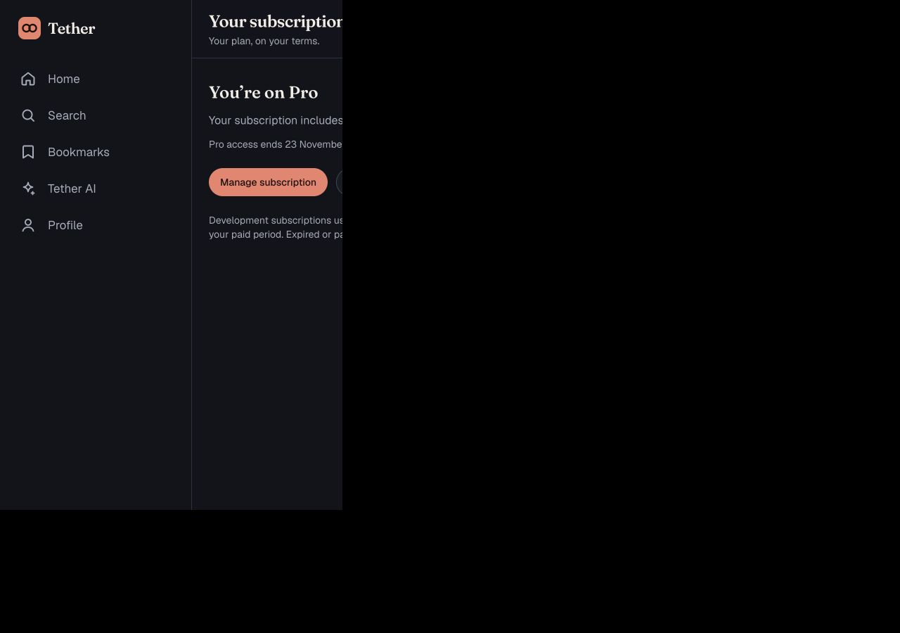
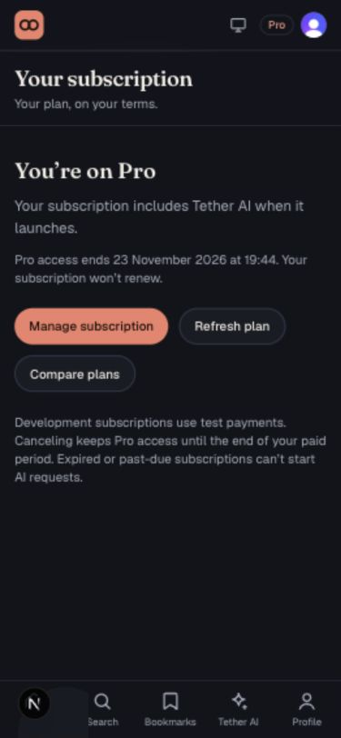

# Phase 6 — Billing

Individual development subscriptions use Clerk's Free (`free_user`) and Pro
(`pro`) plans. Pro costs $10 USD/month, has no annual option or trial, and includes
`tether_agent`. The reproducible development-only configuration is
`config/clerk-billing.dev.json`. No live payments or production deployment.

`/pricing` renders Clerk's user PricingTable and checkout drawer. `/billing`
shows a live server-verified plan, the paid-period end date, refresh/retry, and
Clerk's subscription details/cancellation drawer. The shell links to billing
from the plan badge. Visitors sign in before checkout. AI remains explicitly
marked as arriving in the subsequent agent phases.

## Authorization

`convex/billing.ts` supplies `requireAgentEntitlement(ctx)` for private generation
and internal `requirePro` for trusted background jobs. Call immediately before
model execution. Neither session claims, editable metadata, nor the webhook
cache authorizes generation. User-facing actions accept no user identifier.

The guard uses the pinned `@clerk/backend` Billing SDK:
`billing.getUserBillingSubscription(userId)` and
`billing.getPlanList({ payerType: "user", limit: 100 })`,
matching immutable plan IDs before checking `pro` and `tether_agent`. **Clerk's
subscription response can contain an empty embedded feature list even when its
plan catalog contains the feature** (observed in a successful development
purchase). Do not authorize from the embedded feature list or omit the live
catalog lookup. Missing plan/features, unknown states, Clerk errors, invalid
responses, past-due/incomplete/ended items, trials, future or expired periods
all deny access. Canceled items remain valid only until their paid period ends.
Catalog reads are bounded at 100 plans and fail closed if the plan is absent.
SDK resources use camelCase fields and millisecond timestamps.
Canceled items may retain status `active` with `canceledAt` set; this timestamp
drives the nonrenewal display without revoking the remaining paid access.

## Webhooks

Endpoint: `https://formal-buzzard-436.convex.site/webhooks/clerk`.
Subscribe to `subscription.*`, `subscriptionItem.*`, and `paymentAttempt.*`.
Convex development environment needs `CLERK_SECRET_KEY` (test key) and
`CLERK_WEBHOOK_SIGNING_SECRET` (endpoint-specific secret). Never commit either.
The user completed signing-secret setup during implementation.

`@clerk/backend/webhooks` verifies the raw request. Recognized individual billing
events trigger fresh authoritative reads. Unrelated and organization events
are ignored. A single internal mutation atomically deduplicates Svix event IDs
and accepts only newer Clerk snapshot timestamps. A failed lookup returns 503
so delivery is retried; duplicates return 200. Cached summaries are owner scoped
and never authorize requests. Event IDs persist for replay protection.

## Verification

- Development plans checked through Clerk configuration and Backend API: Pro
  amount 1000 USD cents, annual fee null, trial disabled, correct feature mapping.
- Synthetic development user purchased Pro using Clerk's “Pay with test card”.
- Signed synthetic event: 200 Synced; identical replay: 200 Already processed;
  invalid signature: 400 Invalid signature. No billing event payload can grant
  access without a successful live subscription lookup.
- Policy tests cover lifecycle transitions, expiry boundaries, malformed data,
  lookup failures, feature omission, plan ID mismatch, organization exclusion,
  and stale/replayed snapshots. Lookup tests exercise the installed Billing SDK
  with mocked HTTP responses, including SDK resource deserialization. Uses node:test; no Vitest or E2E tooling.
- Cancellation through Clerk's drawer succeeded; the live authoritative action
  returned `allowed: true`, `canceled: true`, and the original paid-period end.
  Browser text showed “Your subscription won’t renew.”
- Signed-out calls and forged user-id arguments were rejected. A different
  mocked identity could not read the purchaser's cache.
- 21 node:test cases pass, plus ESLint and both TypeScript projects. Production
  Webpack build passes. The default Turbopack build hit an environment worker-port
  restriction; Webpack verification also exposed the previous Turbopack-only
  Tailwind setup. Standard `@tailwindcss/postcss` now compiles utilities for both
  bundlers.
- Failed-payment and expiry denial are covered by deterministic policy fixtures;
  no real renewal failure or month-long subscription expiry was waited for.
- Desktop (1280px) and mobile (375px) billing layouts checked on the running
  localhost:3001 app with no horizontal overflow. The canceled subscription
  displays Pro, its access-until date, and “Your subscription won’t renew.”
- Production CSS checked after the PostCSS fix: flex, hidden, and rounded-full
  utility rules are present in generated stylesheets.

